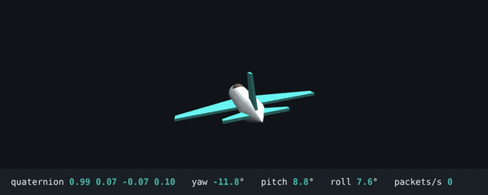
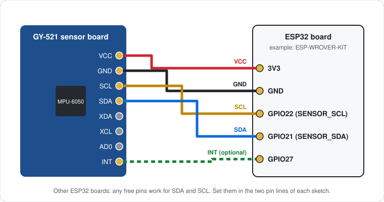
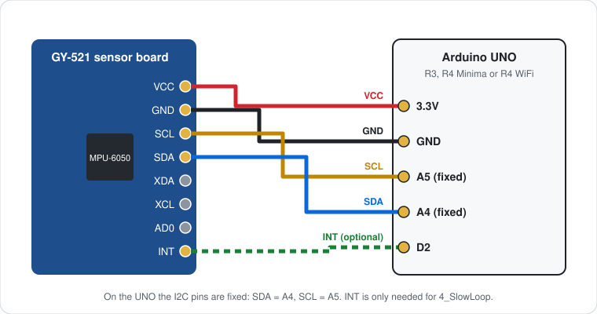
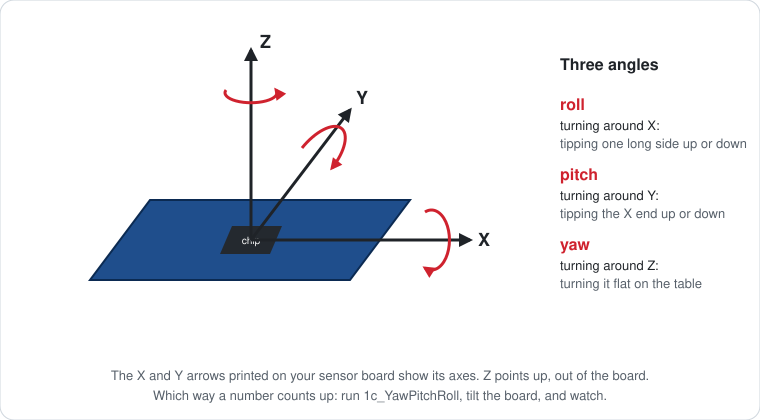

<h1 align="center">MPU6050Classroom</h1>

<p align="center">
  <b>Motion sensing for students — from your first tilt reading to a self-balancing robot.</b>
</p>

<p align="center">
  <a href="../../actions/workflows/compile.yml"></a>
  
  
  
  
  
  
</p>

<p align="center">
  
  <br><sub>The included 3D viewer, here in demo mode (no board connected). With a board, the model follows the sensor.</sub>
</p>

MPU6050Classroom is an Arduino library for the MPU-6050 motion sensor, written
for students. Two lines start the sensor. Problems are explained in plain
words. A frozen sensor is repaired automatically. The examples grow with
the student: a spirit level, a fall detector, a camera gimbal, a robot that
drives exact squares, and Wi-Fi projects that send messages to a phone.

```cpp
mpu.easyStart(Serial, SENSOR_SDA, SENSOR_SCL);   // find, load, calibrate, start
if (mpu.update()) Serial.println(mpu.pitch());   // angle in degrees
```

> [!NOTE]
> This library was written and tested by AI (Claude), at a teacher's request.
> It has been tested on a computer, but **not yet on real hardware**.
> [How this library was made](#how-this-library-was-made) ·
> [Report how it works on your board](../../issues/new?template=hardware_report.yml)

## What makes it different

| | |
|---|---|
| **Two-line start** | `easyStart()` finds the sensor, loads its motion firmware, checks it byte by byte, calibrates and starts. |
| **Plain-word errors** | "No sensor answers. This sketch uses SDA = pin 21 and SCL = pin 22 — check these against your board's pin diagram." It then retries, so a wire can be fixed while the board waits. |
| **Repairs itself** | Loose jumper wires often freeze the sensor. The library notices, repairs it in about a second, and says so. |
| **Ready-made values** | `pitch()`, `roll()`, `yaw()` in degrees; `gForce()` and `shock()` in g. |
| **Readable project logic** | Fall detection, step counting, tap counting and the PID controller live in `TeachMath`, as short code with comments, tested on a computer. |
| **Wi-Fi without editing code** | A setup page on the board asks for the Wi-Fi name and password. Phone messages go through the free ntfy app. |

## Start here

| I want to… | Open this example |
|---|---|
| check that my sensor works | `1a_WhoAmI`, then `1b_SelfTest` |
| see the angles as numbers | `1c_YawPitchRoll` |
| see the board move on screen | `1d_Teapot` with the 3D viewer |
| build something with only the sensor | any level-2 example, for example `2_FallDetector` |
| move a servo with the sensor | `3_CameraGimbal` or `4_LaserTurret` |
| steer a second board by tilting | `3_GestureRemote` + `3_GestureReceiver` (ESP32) |
| build a robot | `4_TurnRobot`, then `4_BalancingRobot` (ESP32) |
| get a message on my phone | `5_WiFiSetup`, then `5_PhoneAlert` |
| show live data in a browser | `5_LiveWebPage` or `5_EarthquakeWebLogger` |

## Boards

| Board | Examples folder | Notes |
|---|---|---|
| ESP32 boards (examples written for the ESP-WROVER-KIT) | `ESP32` | All 30 examples, including radio, background tasks and Wi-Fi |
| Arduino UNO R4 WiFi | `Arduino` | all 25 examples, including Wi-Fi |
| Arduino UNO R4 Minima | `Arduino` | 20 examples (no Wi-Fi) |
| Arduino UNO R3 | `Arduino` | 20 examples (no Wi-Fi) |

A sketch opened from the wrong folder, or a Wi-Fi example on a board
without Wi-Fi, stops at compile time with a message that names the right
choice.

## Install

**Library Manager** (once the library is registered): open
**Sketch > Include Library > Manage Libraries**, search for
**MPU6050Classroom**, click **Install**.

**From a zip file:** download the zip from this page (**Code > Download ZIP**)
or from **Releases**, then choose **Sketch > Include Library > Add .ZIP
Library...** and open the zip. Keep it zipped.

Then:
- **Boards:** for ESP32 install "esp32" by Espressif in the Boards Manager;
  for the UNO R4 install "Arduino UNO R4 Boards". The UNO R3 needs nothing
  extra.
- **Servo library:** the Arduino-folder gimbal and laser turret use it. If
  the IDE reports that `Servo.h` is missing, install **Servo** from the
  Library Manager.
- **Upgrading from MPU6050Teach?** Remove the old `MPU6050Teach` folder
  from `Documents/Arduino/libraries` first.

## Wire the sensor

<p align="center">
  
</p>
<p align="center">
  
</p>

| MPU-6050 pin | ESP32 | UNO R3 / R4 |
|---|---|---|
| VCC | 3.3 V | 3.3 V |
| GND | GND | GND |
| SDA | a free pin — see your board's pin diagram | A4 (fixed) |
| SCL | a free pin — see your board's pin diagram | A5 (fixed) |
| INT *(optional)* | a free pin | pin 2 or 3 on the UNO R3 |

Every sketch starts with two pin lines. Look up your board's pins once and
set them:

```cpp
const int SENSOR_SDA = 21;   // ESP-WROVER-KIT
const int SENSOR_SCL = 22;
```

On the UNO R3 and R4 the I2C pins are fixed at A4 and A5; the Arduino
examples already use them.

**Power:** 3.3 V works with every MPU-6050 board. GY-521 boards also have
their own 3.3 V regulator, so their VCC may go to 5 V instead. Boards
without a regulator must get 3.3 V. If you are not sure which board you
have, use 3.3 V.

<details>
<summary><b>ESP-WROVER-KIT pin notes</b></summary>

GPIO21 and GPIO22 are also connected to the LCD and the camera header, and
GPIO21 to the SD card detect line. GPIO25, GPIO26 and GPIO27 (used by some
examples) are on the camera header, and GPIO25 also on the LCD. If the LCD
or a camera is fitted and you see errors, remove it.
</details>

## Your first sketch

```cpp
#include <MPU6050Classroom.h>

const int SENSOR_SDA = 21;   // look these up for your board
const int SENSOR_SCL = 22;

MPU6050Classroom mpu;

void setup() {
  Serial.begin(115200);
  mpu.easyStart(Serial, SENSOR_SDA, SENSOR_SCL);   // keep the board flat and still
}

void loop() {
  if (mpu.update()) {                // true when new data has arrived
    Serial.print(mpu.pitch());
    Serial.print("  ");
    Serial.println(mpu.roll());
  }
}
```

| After `update()` | Meaning |
|---|---|
| `mpu.yaw()` `mpu.pitch()` `mpu.roll()` | angles in degrees |
| `mpu.gForce()` | total acceleration in g: 1 at rest, 0 in free fall |
| `mpu.shock()` | distance from rest in g: 0 when still, larger during a hit |
| `mpu.pose()` | everything at once, including the direction of gravity |

<p align="center">
  
</p>

## Examples

Open **File > Examples > MPU6050Classroom**, then the folder for your
board. The number at the start of each name is its level.


### Level 1 — First steps

| Example | What it does | ESP32 | UNO R3 | UNO R4 |
|---|---|:-:|:-:|:-:|
| `1a_WhoAmI` | Names the chip; `0x68` means a genuine MPU-6050 | ✓ | ✓ | ✓ |
| `1b_SelfTest` | 8 checks; reports how many ran, passed and failed | ✓ | ✓ | ✓ |
| `1c_YawPitchRoll` | Prints yaw, pitch and roll | ✓ | ✓ | ✓ |
| `1d_Teapot` | Sends the motion to a 3D viewer (teapot or airplane) | ✓ | ✓ | ✓ |

### Level 2 — Projects with the sensor only

| Example | What it does | ESP32 | UNO R3 | UNO R4 |
|---|---|:-:|:-:|:-:|
| `2_SpiritLevel` | Bars show the tilt; the LED lights when level | ✓ | ✓ | ✓ |
| `2_TiltAlarm` | Buzzer when a box or bag is tipped over | ✓ | ✓ | ✓ |
| `2_CrashDetect` | Reports every sudden movement | ✓ | ✓ | ✓ |
| `2_FallDetector` | Detects a drop: free fall, then impact | ✓ | ✓ | ✓ |
| `2_TapCounter` | Counts knocks on the table; reacts to 2 or 3 | ✓ | ✓ | ✓ |
| `2_ShakeDice` | Shake the board to roll a die | ✓ | ✓ | ✓ |
| `2_StepCounter` | Counts steps while the board is carried | ✓ | ✓ | ✓ |

### Level 3 — Bigger projects

| Example | What it does | ESP32 | UNO R3 | UNO R4 |
|---|---|:-:|:-:|:-:|
| `3_DoorMonitor` | Door opened, for how long, and how far | ✓ | ✓ | ✓ |
| `3_BikeTracker` | Jump airtime and lean angle on a bike or skateboard | ✓ | ✓ | ✓ |
| `3_CrashLogger` | Remembers the last 20 crashes, even after a restart | ✓ | ✓ | ✓ |
| `3_CameraGimbal` | A servo keeps a platform level | ✓ | ✓ | ✓ |
| `3_GestureRemote` + `3_GestureReceiver` | Tilt one board to steer another by radio | ✓ | — | — |
| `3_Watchdog` | Reboots the board if the sensor cannot be repaired | ✓ | — | — |

### Level 4 — Advanced

| Example | What it does | ESP32 | UNO R3 | UNO R4 |
|---|---|:-:|:-:|:-:|
| `4_EarthquakeModel` | Shaking of a model building in the Serial Plotter | ✓ | ✓ | ✓ |
| `4_SwingAnalyser` | Peak speed of a bat, racket or club swing | ✓ | ✓ | ✓ |
| `4_LaserTurret` | Aim two servos by moving your hand | ✓ | ✓ | ✓ |
| `4_TurnRobot` | A robot drives a square with exact 90° turns | ✓ | ✓ | ✓ |
| `4_SlowLoop` | Shows how a slow `loop()` loses data (INT pin) | ✓ | ✓ | ✓ |
| `4_BackgroundTask` | Reads the sensor in a separate task | ✓ | — | — |
| `4_BalancingRobot` | Two-wheeled self-balancing robot (PID) | ✓ | — | — |

### Level 5 — Wi-Fi

| Example | What it does | ESP32 | UNO R4 WiFi |
|---|---|:-:|:-:|
| `5_WiFiSetup` | Join Wi-Fi through a setup page; send a test message | ✓ | ✓ |
| `5_PhoneAlert` | A fall or crash sends a message to your phone | ✓ | ✓ |
| `5_LiveWebPage` | Live tilt on any phone or laptop on the same Wi-Fi | ✓ | ✓ |
| `5_DoorMonitorWiFi` | A message when a door opens and closes | ✓ | ✓ |
| `5_EarthquakeWebLogger` | A live shaking graph in the browser | ✓ | ✓ |

Some examples are ESP32-only because they need its radio link (ESP-NOW),
its separate tasks or its hardware watchdog.

**3D viewer for `1d_Teapot`:** close the Serial Monitor, then double-click
`extras/TeacupViewer.html` (Chrome or Edge; it has a demo mode), or open
`extras/processing/TeapotViewer/TeapotViewer.pde` in Processing.

## Wi-Fi projects

**Run `5_WiFiSetup` first.** With no saved settings, the board opens its own
Wi-Fi network called `MPU-Setup-xxxx` (password `mpu6050setup`). Join it
with a phone or laptop and open the setup page — on ESP32 boards it usually
opens by itself; on the UNO R4 WiFi open the address shown in the Serial
Monitor. Enter:

| Field | When |
|---|---|
| Wi-Fi name and password | always (a router or a phone hotspot) |
| School login username | only for networks that ask for a username (WPA2-Enterprise); ESP32 only |
| ntfy topic | for phone messages; a hard-to-guess name is suggested |

The board saves the settings and restarts; later sketches connect by
themselves. To change the settings, type `c` in the Serial Monitor during
the first 5 seconds.

**Phone messages with ntfy.** Install the free **ntfy** app, tap
**Subscribe to topic** and enter your topic name. The board sends to
`ntfy.sh` over an encrypted connection.

> [!IMPORTANT]
> ntfy topic names are public: anyone who knows yours can read its
> messages. Keep it secret and never send private information. The free
> server has no guaranteed uptime and limits how many messages you can
> send; the examples send at most one message every 30 seconds.

Some school networks block outside servers or stop devices from reaching
each other. A phone hotspot or a classroom router then works.

## Troubleshooting

| What you see | Usual cause | What to do |
|---|---|---|
| "No sensor answers" | wrong pin numbers, or a loose wire | compare the two pin lines with your board's pin diagram; push every wire in; the board retries by itself |
| WHO_AM_I is not `0x68` | the board carries a clone or a different sensor | run `1b_SelfTest` and show your teacher |
| Many "repair" messages | loose jumper wires or a poor breadboard contact | use shorter wires and re-seat them |
| Freezes when a servo or motor moves | servos or motors share the sensor's power | give them their own supply, with a common ground |
| Yaw changes slowly while the board is still | yaw drift: the MPU-6050 has no compass | expected for yaw; pitch and roll stay steady |
| "Level" is not level | the board was not flat during calibration | restart with the board on a level surface |
| Compile error naming the other folder | an ESP32 example opened for an UNO, or the other way round | open the same example from the other folder |
| Compile error about Wi-Fi | a Wi-Fi example on a board without Wi-Fi | use an ESP32 or an UNO R4 WiFi |
| The 3D viewer shows nothing | the Serial Monitor is still open | close it; only one program can use the port at a time |
| Setup page does not open | the phone left the board's network, or the page did not open by itself | rejoin `MPU-Setup-xxxx` and type the address from the Serial Monitor |
| No phone message | wrong topic, or the network blocks ntfy.sh | compare the topic in the app with the Serial Monitor; try a phone hotspot |

Still stuck? [Open an issue](../../issues/new/choose) and copy the Serial
Monitor text into it.

## Automatic freeze repair

Always on, in every sketch that reads data with `update()`, `getPose()` or
`readPacket()`.

- **When:** no data for 1.5 s, or data exactly the same for 5 s.
- **What:** frees the I2C wires, resets the sensor, reloads and checks the
  firmware, and restores the start-up calibration — in about one second.
  A failed repair is retried every 2 s.
- **What you see:** one message in the Serial Monitor per repair.
- **Good to know:** a repair that happens often means a wiring problem. A
  slow `loop()` never causes a repair. In rare cases a perfectly still
  board sends exactly the same data for 5 s, which causes one unneeded
  repair, reported like any other. Switch it off with
  `mpu.setAutoRepair(false);`.

## The INT pin

Without the INT pin, the board asks the sensor again and again whether new
data is ready. With it, the sensor signals on a fifth wire the moment each
packet is ready.

```cpp
mpu.useInterruptPin(27);   // after easyStart(); must be an interrupt-capable pin
```

The library listens for 100 ms. If signals arrive, it uses the pin; if not,
it says so and carries on without it. The INT pin lets a sketch count every
packet, lets an ESP32 background task sleep until data arrives, and gives
fast control projects steady timing. It does **not** stop data loss on its
own: during a long `delay()` the signal is ignored too — `4_SlowLoop` shows
this.

## Limits and safety

- **Yaw drifts** slowly over minutes, because the MPU-6050 has no compass.
  Short turns are accurate; long-term heading is not.
- **Ranges:** ±2 g per axis and 2000°/s. A hard crash is detected but not
  measured; a very fast swing is cut off at 2000°/s.
- **"Level"** means "as during calibration": start on a level surface.
- **Power:** servos and motors need their own supply with a common ground.
  On the same supply, their electrical noise can freeze the sensor.

> [!WARNING]
> The fall, crash and phone-alert examples are learning projects, not
> safety devices. Do not rely on them to protect a person.
>
> Laser turret: use only a Class 2 laser module (at most 1 mW). Never point
> it at people, animals, mirrors or windows.

## For experienced users

<details>
<summary><b>Detailed start-up instead of easyStart()</b></summary>

```cpp
Wire.begin(SENSOR_SDA, SENSOR_SCL);       // UNO: Wire.begin();
mpu.reportTo(Serial);                     // short messages, e.g. repairs
mpu.attachDebug(Serial);                  // the full diary (optional)
MpuError e = mpu.begin(DmpVersion::V612, SENSOR_SDA, SENSOR_SCL);
mpu.calibrate();                          // flat and still
mpu.start();
mpu.measureRest();                        // 1 g at rest, for gForce() and shock()
```

`begin()` returns a named error: `MPU_OK`, `MPU_ERR_NO_DEVICE`,
`MPU_ERR_WRONG_CHIP`, `MPU_ERR_FW_WRITE`, `MPU_ERR_FW_VERIFY`, `MPU_ERR_I2C`.
`MPU6050Classroom::errorName(e)` gives its name.
</details>

<details>
<summary><b>Which motion firmware?</b></summary>

The sensor's motion processor runs firmware that the library loads at
every start. `easyStart()` uses V612; pass `DmpVersion::V20` as a fourth
argument to choose the other one.

| | `DmpVersion::V20` | `DmpVersion::V612` |
|---|---|---|
| Image size | 1929 bytes | 3062 bytes |
| Packet | 42 bytes | 28 bytes |
| Self-recalibration | no | yes, after the board sits still |
| Best for | following older tutorials | most projects |
</details>

<details>
<summary><b>What is inside the library</b></summary>

| File | Contents |
|---|---|
| `src/MPU6050Classroom.h` | the sensor class: start-up, repair, INT pin, values |
| `src/TeachMath.h` | project logic: fall detector, tap, step and shake counters, jump timer, angles, gestures, PID |
| `src/TeachPwm.h` | servo and motor helpers for the ESP32 |
| `src/ClassroomWiFi.h` | Wi-Fi setup page, school login, ntfy messages, small web pages |
| `extras/tests/` | computer tests for `TeachMath` |
| `extras/TeacupViewer.html` | 3D viewer for Chrome or Edge |
| `extras/images/` | the pictures in this README |
| `TEACHING.md`, `CHANGELOG.md` | teacher guide, version history |
| `.github/` | the automatic compile check and the hardware report form |
</details>

## What has been tested

| Check | Result |
|---|---|
| Computer tests of `TeachMath` (`extras/tests/test_math.cpp`) | 75 of 75 checks ran, 75 passed |
| Firmware images | byte counts match the sizes declared in the original source (1929 and 3062 bytes) |
| Compiling every example for every board it is meant for | 105 builds: 95 compiled, 10 stopped on purpose (Wi-Fi examples on boards without Wi-Fi), 0 failed; no warnings in the library's own code |
| On real hardware | **not yet run** — run `1b_SelfTest` first on your own board |

<details>
<summary><b>Build details</b></summary>

| Board | Builds | Compiled | Stopped on purpose | Failed |
|---|---|---|---|---|
| ESP32 Wrover Kit (`ESP32` folder) | 30 | 30 | 0 | 0 |
| UNO R3 (`Arduino` folder) | 25 | 20 | 5 (Wi-Fi) | 0 |
| UNO R4 Minima (`Arduino` folder) | 25 | 20 | 5 (Wi-Fi) | 0 |
| UNO R4 WiFi (`Arduino` folder) | 25 | 25 | 0 | 0 |

Tools: ESP32 Arduino core 3.3.12; Arduino AVR core 1.8.8 and Renesas core
1.6.0 built from Arduino's source code with Ubuntu's compilers (avr-gcc
7.3.0, arm-none-eabi-gcc 13.2). The R4 builds needed one extra flag
(C++14) because the newer compiler rejects a line in the R4's own Wi-Fi
library. The ESP32 core 2.x code paths were not compiled.
</details>

Run the computer tests yourself:

```
cd extras/tests
g++ -std=c++17 -I ../../src test_math.cpp -o test_math && ./test_math
```

### Confirmed on real hardware

No reports yet. If you run an example on a real board — whether it works
or not — please [send a hardware report](../../issues/new?template=hardware_report.yml).
Confirmed boards will be listed here.

| Board | Sensor board | Examples confirmed | Report |
|---|---|---|---|
| — | — | — | — |

## How this library was made

The idea came from a teacher. He had seen the MPU-6050 freeze in his
students' projects, which is frustrating for beginners, and he wanted a
stable motion-sensor library that is easy to use. So he asked Claude, an
AI assistant made by Anthropic, for help.

**The code was written and tested by AI.** Claude wrote the library, all
the examples, the 3D viewer and the tests, following the teacher's
requirements and his reviews of each step. The AI testing means two
things: the project logic passes tests run on a computer, and every
example compiles for every supported board (see
[What has been tested](#what-has-been-tested)). The code has **not yet
been run on real hardware.** Please report problems you find on a real
board in the Issues tab.

## For teachers

[TEACHING.md](TEACHING.md) has a suggested lesson order, what students
learn at each level, the most common mistakes and what to say, classroom
safety, and how the library keeps the load on students low.

Version history: [CHANGELOG.md](CHANGELOG.md).

## Credits and licence

- The two DMP firmware images in `src/` are InvenSense's motion programs,
  captured and published under the MIT licence by Jeff Rowberg's
  [i2cdevlib](https://github.com/jrowberg/i2cdevlib) and maintained in
  [ElectronicCats/mpu6050](https://github.com/ElectronicCats/mpu6050).
- Everything else — the library, the examples, the viewers and the tests
  — was written by Claude (Anthropic's AI assistant) for a teacher who
  started the project and reviewed each step.
- Licence: [MIT](LICENSE). The firmware images keep their own MIT licence
  and copyright notice (see [LICENSE](LICENSE)).
